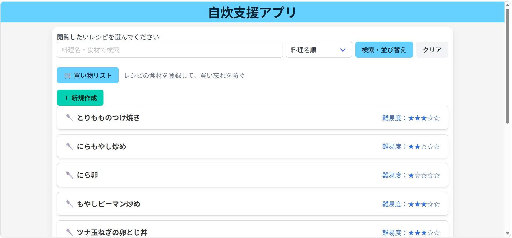
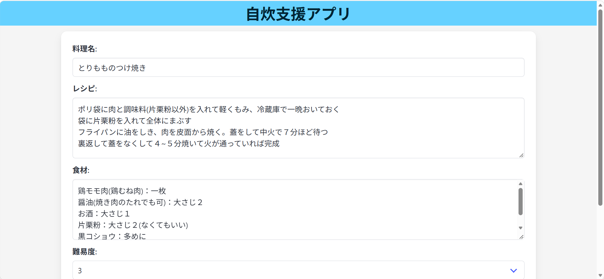
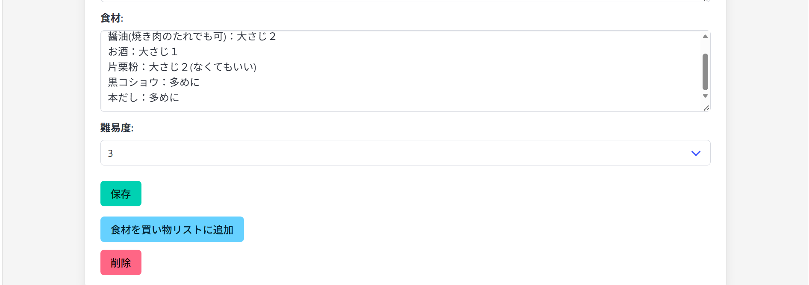
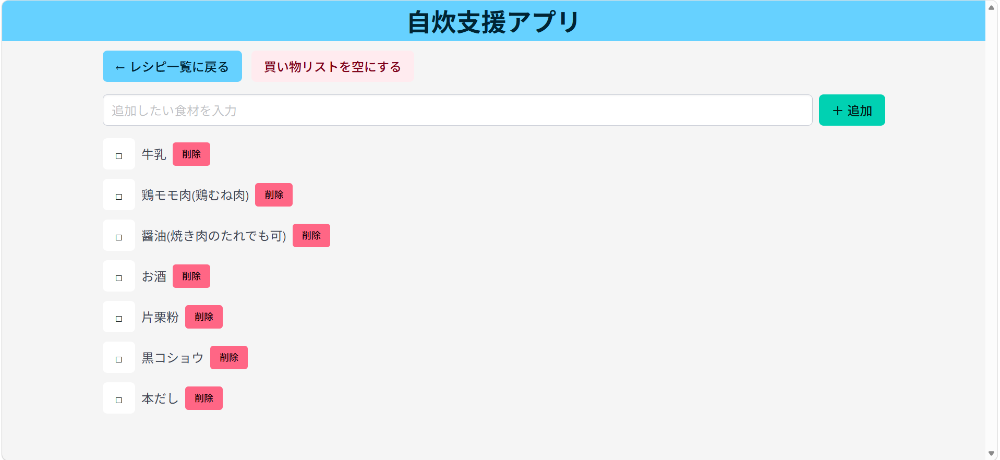

# 自炊支援アプリ

## 概要
一人暮らしで使うレシピを記録するために開発したWebアプリです。

料理のレシピを管理する機能に加えて、買いたいものをメモしておく買い物リスト機能を実装しています。
日々の自炊をより便利にすることを目的としています。

## 開発の背景
私は大学進学を機に一人暮らしを始め、日常的に自炊をしています。

その中で、自分なりに簡単なレシピを考えたり様々なサイトから参考にしたレシピを使用したりしています。  
それらのレシピを見やすくにまとめておく他、必要な食材をまとめて確認したりできるアプリがあれば便利だと考えました。

そこで、本アプリを開発しました。

## 使用技術
- Python
- Flask
- Flask-SQLAlchemy
- SQLite
- HTML
- CSS
- Bulma

## 主な機能

### 1. レシピ管理機能
- 新規レシピの登録
- レシピの編集
- レシピの削除
- 料理名・食材によるレシピの検索
- 難易度の設定（5段階）
- 料理名・難易度による並び替え

### 2. 買い物リスト機能
- レシピに登録された材料を買い物リストに追加
- 任意の食材を手動で追加
- 購入済みの食材をチェック
- 食材の個別削除
- 買い物リストの一括削除

## 工夫した点

### レシピと買い物リストの連携
レシピに登録された材料をボタン一つで買い物リストに追加できるようにしました。

材料は「材料名：分量」の形式で管理し、
買い物リストには材料名のみを登録する仕組みにしています。

### レシピ詳細の見やすさ
レシピの登録には簡潔な手順と食材、難易度のみを記入することで余計な情報を入力する手間を避けています。  
難易度を入力してをくことでレシピを読んでも難しさ・面倒さをわかりやすくしています。

### 操作のしやすさ
買い物リストでは、購入済みの食材をチェックできるようにしました。

また、食材の個別削除は確認なしで実行できる一方、
一括削除では確認画面を表示することで、深刻な誤操作を予防しています。

## 今後の改善
- 画面デザインの改善
- 操作性の向上
- アプリのWeb公開

## アプリの画面

### レシピ一覧画面

料理名や食材による検索、難易度による並び替えを行います。

### レシピ編集画面

料理名、手順、食材、難易度を登録・編集を行います。　
また、食材をすべて買い物リストに追加登録できます。

### 買い物リスト画面

レシピ中の食材を追加したり、購入済みの食材をチェックする。　
別で任意の食材をメモに追加できます。

